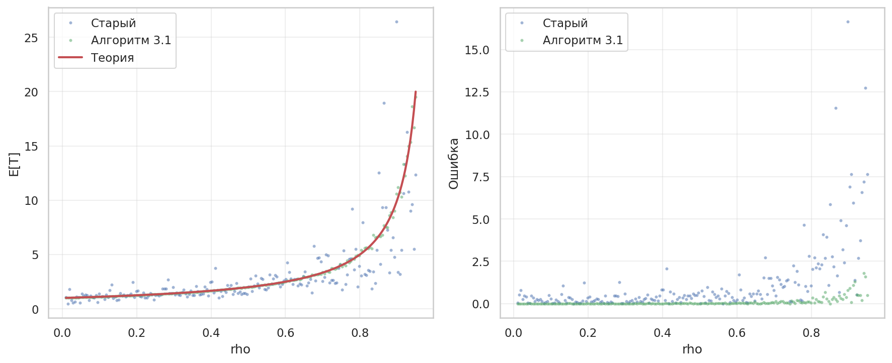
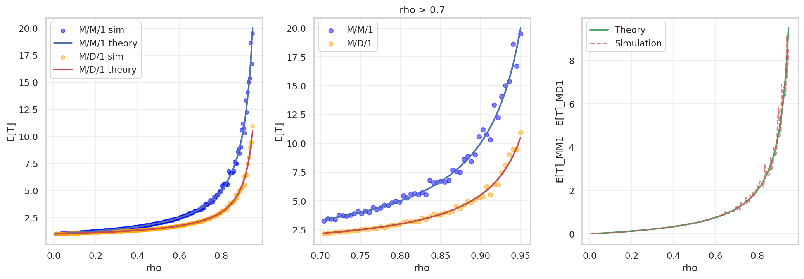
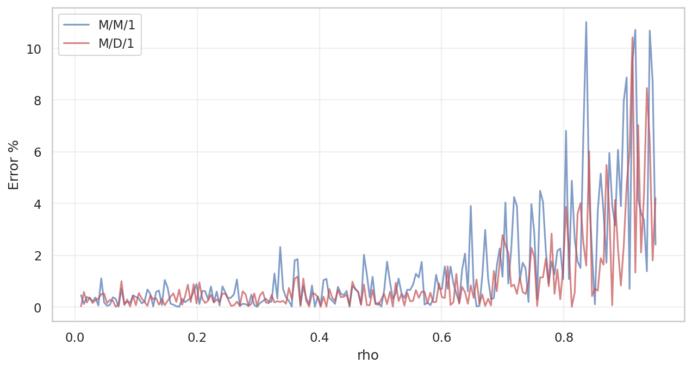

# Симуляция систем массового обслуживания M/M/1 и M/D/1

Численные эксперименты по теории массового обслуживания: имитационное моделирование систем **M/M/1** и **M/D/1** с помощью алгоритма 3.1 (моделирование системы GI/G/K) из книги П. П. Бочарова и А. В. Печинкина «Теория массового обслуживания» (стр. 110–114) и сравнение результатов с аналитическими формулами.

> **Abstract (EN):** Discrete-event simulation of M/M/1 and M/D/1 queues using the GI/G/K simulation algorithm (Bocharov & Pechinkin, *Queueing Theory*, pp. 110–114), compared against closed-form formulas for the mean queue length E[N] and the mean sojourn time E[T], with RMSE/MAE error analysis and plots.

## Что внутри

| Скрипт | Что считает |
|---|---|
| `scripts/mm1_md1_mean_number.py` | Среднее число заявок в системе **E[N]** для M/M/1 и M/D/1: «быстрая» симуляция на numpy, алгоритм 3.1 и теория. Выводит таблицу, среднее время расчёта, RMSE и график. |
| `scripts/mm1_md1_mean_sojourn_time.py` | Среднее время пребывания **E[T]**: сравнение методов симуляции, M/M/1 против M/D/1, анализ относительной ошибки по диапазонам ρ и отношение E[T]_MD1 / E[T]_MM1. Метрики RMSE/MAE. |

## Теоретические формулы

Обозначения: ρ = λ/μ — загрузка системы, λ — интенсивность входящего потока, μ — интенсивность обслуживания (в коде μ = 1).

**M/M/1**

| Величина | Формула |
|---|---|
| E[N] | ρ / (1 − ρ) |
| E[T] | 1 / (μ · (1 − ρ)) |
| E[W] | ρ / (μ · (1 − ρ)) |
| E[Q] | ρ² / (1 − ρ) |

**M/D/1**

| Величина | Формула |
|---|---|
| E[N] | ρ + ρ² / (2 · (1 − ρ)) |
| E[T] | (2 − ρ) / (2 · μ · (1 − ρ)) |
| E[W] | ρ / (2 · μ · (1 − ρ)) |
| E[Q] | ρ² / (2 · (1 − ρ)) |

где E[N] — среднее число заявок в системе, E[T] — среднее время пребывания, E[W] — среднее время ожидания, E[Q] — средняя длина очереди.

## Структура репозитория

```
queueing-theory-simulation/
├── scripts/
│   ├── mm1_md1_mean_number.py        # E[N]: M/M/1 и M/D/1
│   └── mm1_md1_mean_sojourn_time.py  # E[T]: M/M/1 и M/D/1
├── figures/                          # графики, генерируемые скриптами
├── .github/workflows/ci.yml          # CI: проверка синтаксиса
├── requirements.txt
├── .gitignore
├── LICENSE
└── README.md
```

## Установка

```bash
git clone <url-репозитория>
cd queueing-theory-simulation
python -m venv .venv
source .venv/bin/activate        # Windows: .venv\Scripts\activate
pip install -r requirements.txt
```

Требуется Python 3.9+.

## Запуск

```bash
python scripts/mm1_md1_mean_number.py
python scripts/mm1_md1_mean_sojourn_time.py
```

Скрипты выводят таблицы значений, метрики RMSE/MAE и время расчёта, а графики сохраняют в папку `figures/`.

## Примеры результатов

Графики ниже получены запуском скриптов с параметрами по умолчанию (ρ ∈ [0.01, 0.95], μ = 1, зерно ГПСЧ = 42).

![Среднее число заявок E[N]](figures/mm1_md1_mean_number.png)







## Зависимости

- [numpy](https://numpy.org/)
- [pandas](https://pandas.pydata.org/)
- [matplotlib](https://matplotlib.org/)
- [seaborn](https://seaborn.pydata.org/)
- [scikit-learn](https://scikit-learn.org/)

## Литература

- Бочаров П. П., Печинкин А. В. *Теория массового обслуживания*. — М.: Изд-во РУДН, 1995. — С. 110–114 (алгоритм 3.1, формулы для M/M/1 и M/D/1).

## Лицензия

[MIT](LICENSE)
